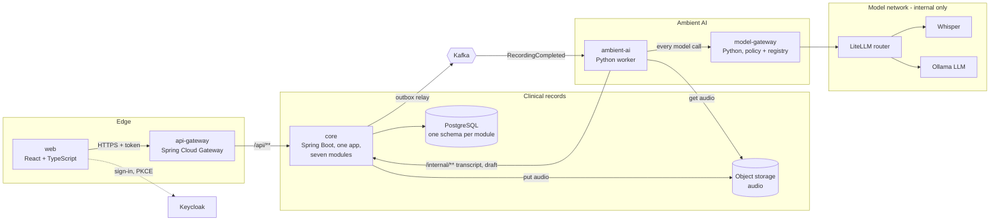
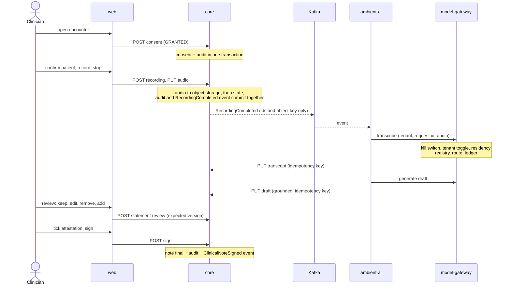

# Afia Ambient: architecture

Status of this document: **PHASE 0 / AS-DESIGNED**. It describes the code in this repository.
What has and has not been executed is recorded in [CURRENT_STATE.md](CURRENT_STATE.md); nothing
here is a claim that the system has run in production.

This architecture replaces the architecture sections of the master blueprint
(`docs/blueprint/`). The blueprint's requirements, safety rules and feature catalogue still
apply and are tracked in [features/register.yaml](features/register.yaml).

## 1. Shape: five deployables

| Deployable | Technology | Port | Owns | Does not own |
|---|---|---|---|---|
| `web` | React 19, TypeScript, Vite | 5173 | Screens only; no clinical logic | Any record, any rule |
| `api-gateway` | Java 25, Spring Boot 4.1, Spring Cloud Gateway | 8080 | Token check at the edge, CORS, correlation id, route to core | Business state; the `/internal` API is not routed |
| `core` | Java 25, Spring Boot 4.1, JDBC, Flyway | 8081 | All authoritative records: patient reference, encounter, consent, recording metadata, transcript, note, audit ledger, outbox | Model access, audio bytes in the database |
| `model-gateway` | Python 3.13, FastAPI | 8000 | Tenant AI policy, kill switch, residency, model and prompt registry, routing, fallback, execution ledger | Clinical records, clinical decisions |
| `ambient-ai` | Python 3.13, aiokafka | 8000 | The pipeline recording -> transcript -> grounded draft. Stateless | Any record; it never calls a model directly |

Why five and not eighteen: the blueprint itself asks for a right-sized walking skeleton for a
team of one to three engineers and forbids adding services without a demonstrated need. The
boundaries that matter are already hard: the model boundary is a separate process on a separate
network, and the clinical modules are separated inside `core` in a way that is tested (section 3).

## 2. Rules that the code enforces

| Rule | Where it is enforced |
|---|---|
| Tenant comes only from the validated token | `CurrentUser`; no endpoint accepts a tenant. Gateway strips `X-Tenant-Id` and similar headers. Test: `aTenantNamedInTheRequestIsIgnored` |
| Another tenant's record looks like "not found" | Every query filters by tenant. Test: `anotherTenantCannotSeeOrChangeAnything` |
| No capture or AI without consent | `MediaService.start/upload`, `TranscriptService.store`, `NoteService.storeDraft` all re-check consent |
| Consent withdrawal stops the AI path | `EncounterService.revokeConsent` returns the encounter to consent-pending and quarantines audio in the same transaction |
| The clinician confirms the patient before recording | `patientConfirmed` is required; one active recording per encounter (unique index) |
| AI output is a draft | Note states `AI_GENERATED -> UNDER_REVIEW -> SIGNED`; only a clinician's attested sign-off makes it final |
| A statement not found in the transcript blocks sign-off | Evidence is re-checked by `ambient-ai` and again by `core`; unsupported statements must be edited or removed |
| A signed note cannot change | API refuses; a database trigger refuses too. Corrections will be amendments (Phase 2) |
| Evidence is written with the action | `AuditService.record` joins the caller's transaction (fail closed). The ledger is append-only (trigger) and hash-chained per tenant |
| No dual write | `Outbox.record` requires an open transaction; the relay publishes afterwards, in order, at least once |
| No duplicate clinical effect | Transcript and draft carry idempotency keys derived from the event id |
| All model access through model-gateway | No provider SDK in core (architecture test); `ambient-ai` has only a model-gateway client; models sit on an internal network that only model-gateway joins |
| Residency and AI toggles fail closed | model-gateway denies when the kill switch, tenant toggle, use-case toggle or allowed-region check fails |
| A real recording never gets a made-up transcript | The local registry contains no synthetic model and no fallback to one (tested) |
| No clinical content in events, logs or the audit ledger | Events carry ids and object references; audit rows carry ids and action names; error bodies carry codes only |

## 3. Inside `core`: modules that can be extracted later

One Spring Boot application, one PostgreSQL database, **one schema per module**. A module's SQL
touches only its own schema; cross-module references are plain ids with no foreign keys across
schemas. `ArchitectureRulesTest` fails the build if a module reads or writes another module's
schema. Modules call each other through Java service methods, never through tables.

| Module (package / schema) | Authoritative data | Classification |
|---|---|---|
| `patient` | Patient reference: hospital record number, issuer, name, date of birth | System of record (reference only; the EHR stays the master) |
| `encounter` | Encounter lifecycle, consent decisions and versions | System of record |
| `media` | Recording metadata, checksum, object reference | System of record for metadata; audio in object storage |
| `transcript` | Timestamped segments, speaker, language, provenance | Derived, with provenance |
| `note` | Note, versions, statements, evidence links, sign-off | Draft is derived; signed note is system of record |
| `audit` | Hash-chained ledger | Evidence |
| `platform` | Outbox, correlation id, security, error format | Infrastructure |

Extraction triggers (each needs an ADR): a module needs its own scaling profile or release
cadence; a different team owns it; its data needs a different residency or retention boundary;
or its failure must not affect sign-off. Expected order: `media` + `transcript` (throughput),
then `audit` (independent evidence store), then `consent` when policy becomes complex.

## 4. Golden path

Failure behaviour: model-gateway refuses (policy) -> `ambient-ai` reports
`processing-failed` -> the encounter shows "draft could not be prepared" and the clinician
writes the note by hand. A dependency is down -> three attempts with backoff, then the same
report. Core refuses a late result (for example consent was withdrawn) -> final, nothing retried.
An event that cannot be handled at all -> copied to `afia.encounter.events.v1.dlq`, offset
committed, consumer continues.

## 5. State machines

Encounter: `CONSENT_PENDING -> READY -> RECORDING -> PROCESSING -> REVIEW -> SIGNED`
(`EXPORTED` and `CLOSED` are reserved for Phase 2). Consent withdrawal moves `READY`,
`RECORDING` or `PROCESSING` back to `CONSENT_PENDING`. A handwritten note moves
`CONSENT_PENDING`, `READY` or a failed `PROCESSING` straight to `REVIEW`. Every transition is a
guarded update (`WHERE state IN (...)`); an invalid transition is a 409.

Note: `AI_GENERATED -> UNDER_REVIEW -> SIGNED`; a handwritten note starts at `UNDER_REVIEW`.
Statement: `PENDING -> ACCEPTED | EDITED | REJECTED`.
Recording: `STARTED -> UPLOADED | QUARANTINED`.

## 6. Contracts that exist today

HTTP, through the gateway (all need a token; tenant is implicit):

| Method and path | Role |
|---|---|
| `GET /api/me` | any |
| `POST /api/patients`, `GET /api/patients?query=` | clinician, nurse, tenant-admin |
| `POST /api/encounters`, `GET /api/encounters`, `GET /api/encounters/{id}` | clinician creates; clinical and admin roles read |
| `POST /api/encounters/{id}/consent`, `POST .../consent/revoke` | clinician, nurse |
| `POST /api/encounters/{id}/recordings`, `GET .../recordings/active`, `PUT .../recordings/{rid}/audio` | the encounter's own clinician |
| `GET /api/encounters/{id}/transcript`, `GET .../note`, `GET .../note/versions` | clinician, nurse, compliance-officer (reads are audited) |
| `POST .../note/manual`, `POST .../note/statements`, `POST .../note/statements/review`, `POST .../note/sign` | the encounter's own clinician |
| `GET /api/audit/events?resourceId=`, `GET /api/audit/verify` | compliance-officer, security-auditor, tenant-admin |

Service to service (role `svc-ambient`, not routed by the gateway):
`PUT /internal/encounters/{id}/transcript`, `PUT .../draft`, `POST .../processing-failed`.

model-gateway: `POST /v1/transcriptions`, `POST /v1/generations` (role `svc-ambient`);
`GET /v1/executions/{id}`, `PUT /v1/admin/tenants/{tenant}/policy`, `PUT /v1/admin/kill-switch`
(role `platform-operator`).

Events, topic `afia.encounter.events.v1`, key `tenantId:aggregateId`, JSON envelope with
`eventId, eventType, schemaVersion, tenantId, aggregateType, aggregateId, aggregateVersion,
correlationId, causationId, occurredAt, producer, classification, data`:

| Event | Producer | Consumer today |
|---|---|---|
| `EncounterCreated`, `ConsentGranted`, `ConsentRefused`, `ConsentRevoked` | core / encounter | none yet |
| `RecordingCompleted` | core / media | ambient-ai |
| `TranscriptCompleted`, `DraftReady` | core / transcript, note | none yet |
| `ClinicalNoteSigned` | core / note | none yet (FHIR export and notifications in Phase 2) |

## 7. Identity and roles

Keycloak realm `afia`. The web app signs in with the authorization-code flow and PKCE; tokens
stay in memory. Services validate signatures against the realm's key set. Roles: `clinician`,
`nurse`, `tenant-admin`, `compliance-officer`, `security-auditor`, `platform-operator`,
`svc-ambient`. The tenant is a user attribute that only an administrator can set, mapped to the
`tenant_id` claim. Multi-factor sign-in is not configured yet (Phase 1).

## 8. AI governance in the code

Every model call creates an execution record: tenant, use case, request id, model and version,
prompt and version, policy version, route (primary or fallback), attempts, hashes of input and
output, latency. It holds no content. The result returned to the caller carries that provenance,
and core stores it on the transcript and on the note, where the clinician can see it.

Registries are versioned files in git, reviewed like code: `registry.yaml` (synthetic models for
tests and offline demos) and `registry.local.yaml` (local Whisper and Ollama through the LiteLLM
router). The synthetic models produce a fixed fictional consultation; the web app marks such
output as a demonstration.

Not yet built: persistent policy and ledger (in memory today), evaluation harness, datasets,
feedback capture, release approval records. No model here has passed a clinical evaluation gate.

## 9. Deliberately absent

| Not included | Why | Reopen when |
|---|---|---|
| Redis | No approved use yet | Gateway rate limiting or session features (Phase 1) |
| Workflow engine (Temporal or Camunda) | Guarded state + outbox is enough for one linear flow | Two of: multi-hour waits, human approval steps across services, compensation, timers |
| Schema registry | One producer, one consumer, one JSON envelope | A second team or external consumer |
| Search engine, analytics store | No use case yet | A reporting requirement with a data classification |
| Service mesh, mTLS between services | Single trust zone in local development | First shared or production-like environment |
| pgvector use | Image includes it; nothing uses it | Retrieval over prior encounters or terminology |
| Separate identity-tenant service | Keycloak holds users, roles and tenant attribute | Tenant administration screens (Phase 2) |

## 10. Technology register

| Area | Choice | Version source |
|---|---|---|
| Java services | Java 25, Spring Boot 4.1.2, Spring Cloud 2025.1.3 | `pom.xml` |
| Data | PostgreSQL 18 (pgvector image), Flyway migrations | `compose.yaml`, `services/core/src/main/resources/db/migration` |
| Messaging | Apache Kafka 4.1 (KRaft) | `compose.yaml` |
| Object storage | S3 API; MinIO locally | `compose.yaml` |
| Identity | Keycloak 26.8 | `compose.yaml`, `infra/keycloak/afia-realm.json` |
| Python services | Python 3.13, FastAPI, httpx, aiokafka, boto3 | `services/*/pyproject.toml` |
| Model routing | LiteLLM router; Whisper (Speaches server); Ollama | `compose.yaml`, `infra/litellm/config.yaml` |
| Web | React 19, TypeScript 5.9, Vite 8, oidc-client-ts, Vitest | `web/package.json` |
| CI | GitHub Actions: Maven verify, pytest, ruff, web checks, secret and dependency scans | `.github/workflows/ci.yml` |

Container image tags in `compose.yaml` have not been pulled or run in the environment where
this was written; see CURRENT_STATE.md.
